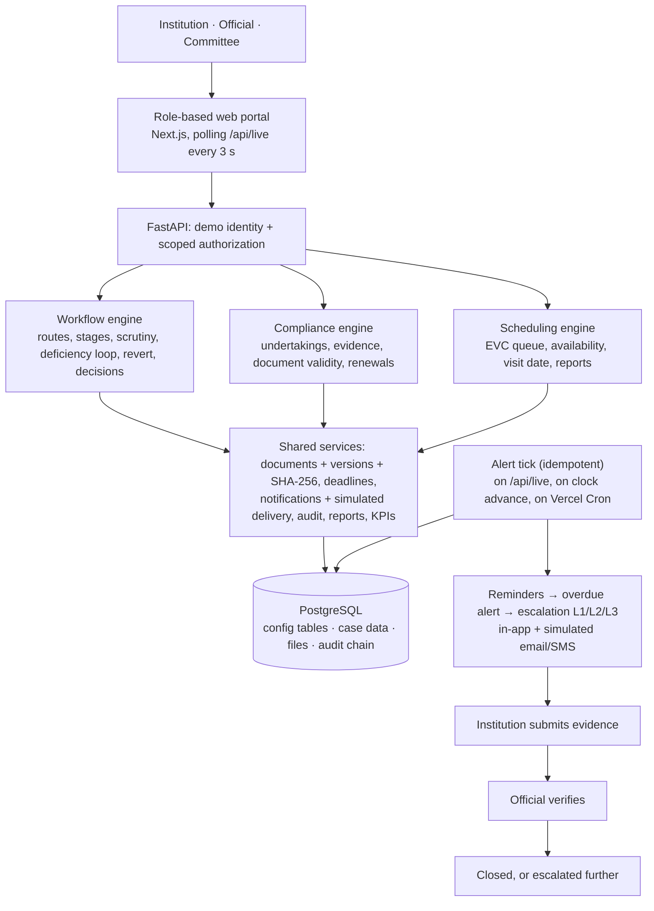

# Argus

**Integrated AICTE Approval Workflow Automation, Compliance Monitoring and Alert Management System**
SIH 2026 · Problem statement PS26262 · Smart Automation

> **SYNTHETIC DATA. Prototype, not an official AICTE system.** All institutions, officers and committee
> members are fictional. Every rule, time limit and reminder day is an **illustrative assumption, not an
> official APH figure**. Emails and SMS are simulated. Argus never approves, rejects, grants or denies anything.

## The problem

AICTE approves technical institutions through stages such as scrutiny and re-scrutiny, Expert Visit
Committee (EVC) visits and SAC/SHC review. Some approvals carry time-bound undertakings, and institutions
must keep documents such as land leases valid. Today officers in each Region track all of this by hand, so
deadlines slip, visits get delayed and documents expire unnoticed.

## What Argus does

Argus ("the hundred-eyed watchman") is one configurable platform for three roles (Institution, Official,
Committee) that:

1. **Routes** every application through the stages its type requires, and moves it on automatically when a stage is done.
2. **Monitors** pendency, ageing, EVC scheduling, undertakings and document validity on role-based dashboards that refresh live.
3. **Alerts and escalates**: reminders before a deadline, an overdue alert after it, then escalation L1 to L3 up a configurable chain. Each alert fires once, on its configured day.
4. **Records everything** in an append-only, hash-chained audit trail with a "Verify chain" button.

Humans decide. Decisions and committee recommendations are recorded by the competent person, with who,
when and why. Automation is limited to routing, reminders, escalations, drafting and record keeping.

## Architecture



All deadlines read time from one **simulated platform clock** (`+1d / +7d / +30d` in the top bar). The
clock moves one day at a time and runs the alert tick each day, so reminders fire on exactly their day.
Details: [docs/DETAILS.md](docs/DETAILS.md).

## Run it on Windows

Needs Python 3.11 to 3.13, Node 20+, pnpm and PostgreSQL 14+.

```powershell
copy .env.example .env      # then set DATABASE_URL (GROQ_API_KEY is optional)
pnpm run setup              # venv + packages, frontend packages, tables, synthetic data
pnpm dev                    # API on :8000, web on :3000
```

Open http://localhost:3000 and pick a demo user. `pnpm run setup` must be written with `run`,
because `pnpm setup` is a built-in pnpm command.

No Postgres password at hand? `pnpm db:local` starts a project-local cluster on port 5433 (needs the
PostgreSQL `bin` folder on PATH); use `DATABASE_URL=postgresql://argus@localhost:5433/argus`.

| Command | What it does |
|---|---|
| `pnpm db:init` / `pnpm db:seed` | create tables / load the synthetic dataset (`data/seed.copy.gz`) |
| `pnpm db:generate` | rebuild the dataset by replaying ~300 simulated days through the engines (deterministic) |
| `pnpm db:reset` | restore the seeded state (same as the Reset button) |
| `pnpm test` | 39 pytest tests (uses a separate `<db>_test` database) |
| `pnpm smoke` | headless demo scenario through the API, prints the KPI table |
| `pnpm e2e` | Playwright click-through of the demo path in the real UI (needs `pnpm dev`; uses installed Edge) |
| `pnpm screens <user> <paths…>` | screenshots at 1366x768 and 1920x1080 |

## Demo

A 4 to 5 minute script is in [docs/DEMO.md](docs/DEMO.md). The **Guide and demo** page in the app can also
run the scenario step by step, with captions written from what actually happened.

## Measured results

From `pnpm smoke` on the synthetic dataset (guided scenario, then 37 simulated days). Targets are our own
suggestions, not official requirements. Every value is computed live on the **Performance** page.

| # | KPI | Result | Suggested target |
|---|---|---|---|
| 1 | Workflow routing accuracy (61 applications) | 100% | 100% |
| 2 | Alert timeliness (462 alerts, fired on their configured day) | 100% | 100% |
| 3 | Deadline tracking reliability (38 open overdue items checked) | 0 missed | 0 |
| 4 | Pendency visibility (31 overdue cases on dashboard and report) | 100% | 100% |
| 5 | Manual follow-up reduction (285 reminders, 57 overdue alerts, 120 escalations; 1 follow-up per alert assumed) | 462 | shown as a count |
| 6 | Escalation coverage (38 overdue items) | 100% | 100% |
| 7 | Audit completeness (1,078 records) and chain verification | 100%, chain valid | 100%, valid |
| 8 | Average days per stage, AICTE + institution | Completeness 3.5 + 1.2 · Scrutiny 11.2 + 3.5 · EVC 29.5 · SAC/SHC 7.9 · Decision 3.6 | shown |

The routing self-test on the Performance page also pushes one test application of every type through all
its stages inside a rolled-back transaction: 7 of 7 routed correctly.

## Tech stack

FastAPI + Pydantic v2 · PostgreSQL via psycopg 3 and plain SQL (no ORM) · Next.js 16 (App Router), React 19,
TypeScript, Tailwind CSS 4, Zustand, Recharts, lucide-react · Source Serif 4 and Inter bundled locally ·
Groq (optional, free tier) for drafting, with offline templates · pytest, ruff, Playwright · pnpm.
Deploys as one Vercel project (Next.js and FastAPI as two services, see `vercel.json`) with Neon Postgres.

## Future scope (not built in v1)

- Integration with real AICTE systems, real SSO, DigiLocker and e-Sign, real login and password management
- Real email, SMS and WhatsApp delivery
- Automated document content checks (OCR, authenticity checks)
- AI-based risk scoring or prediction of delays
- Mobile app and multilingual UI
- Advanced analytics and cross-year trends
- An admin / user-management role and self-registration
- Full APH rule coverage for every approval type and scenario
- Geo-tagged inspections and video visits
