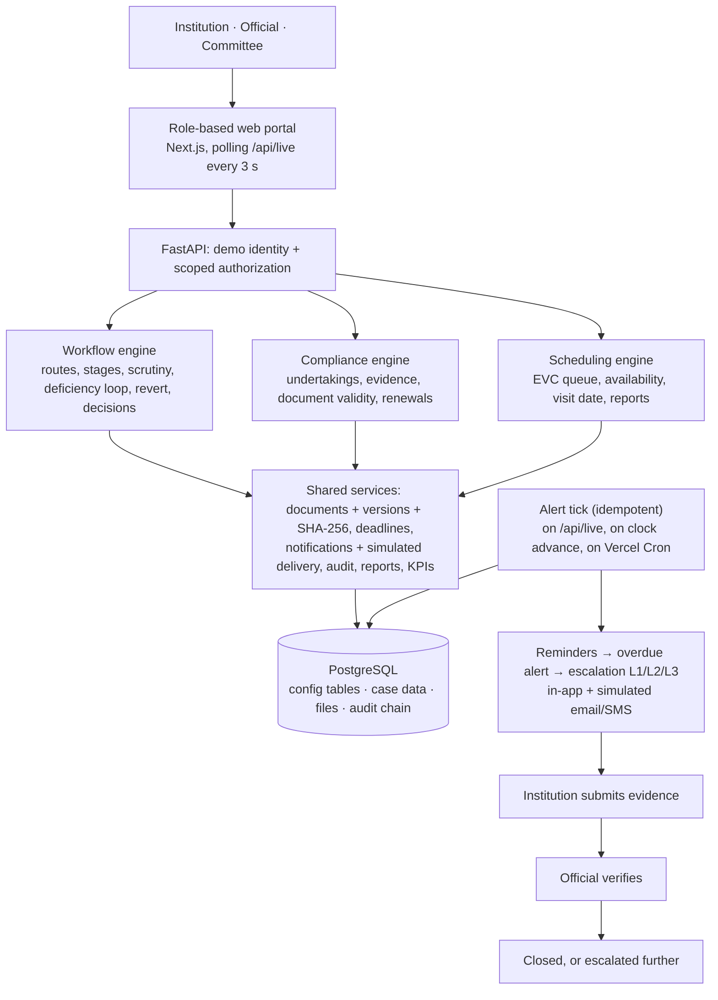
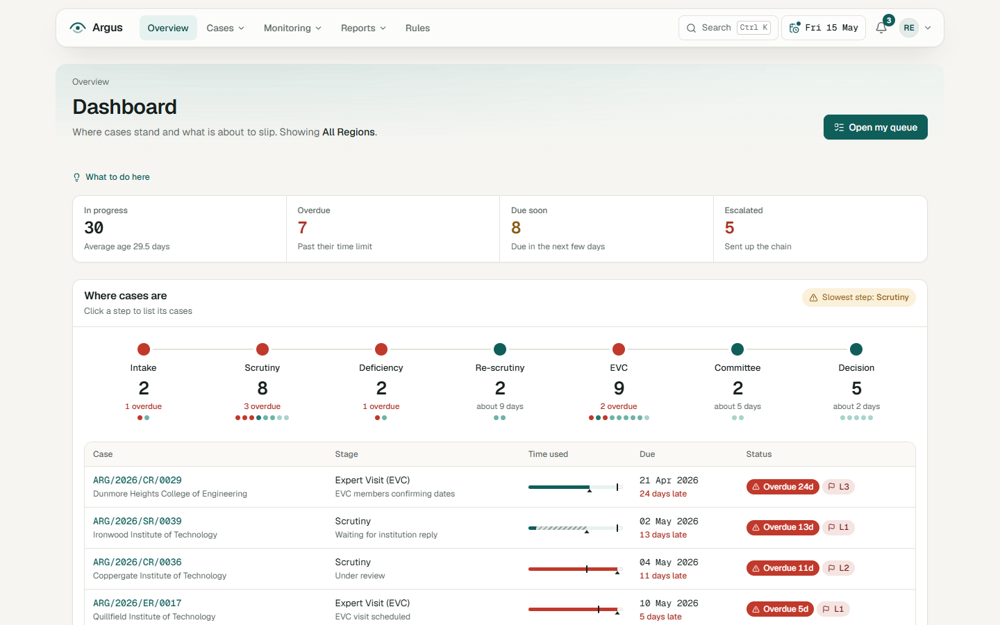
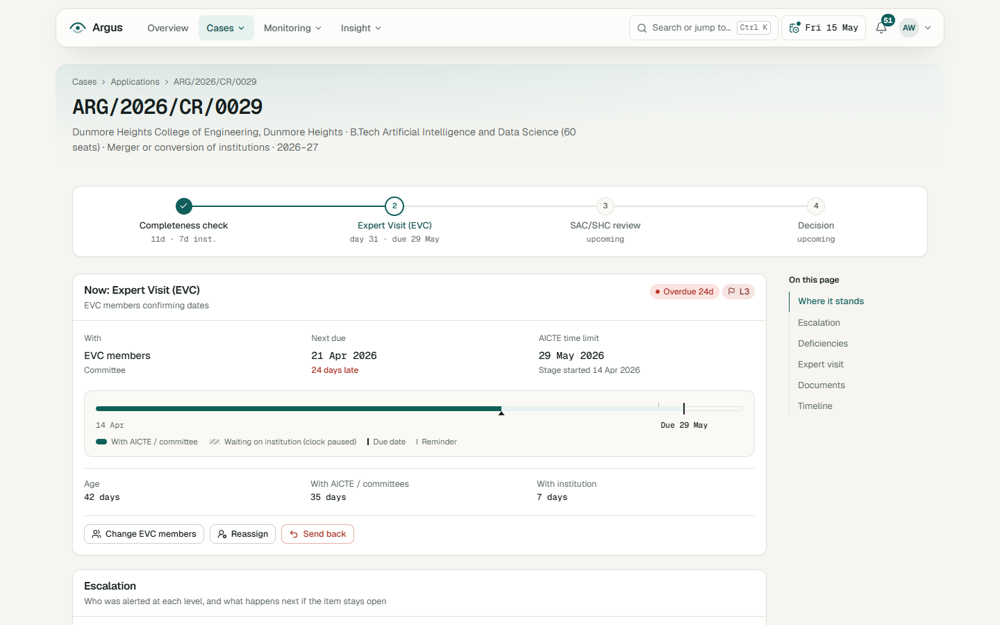
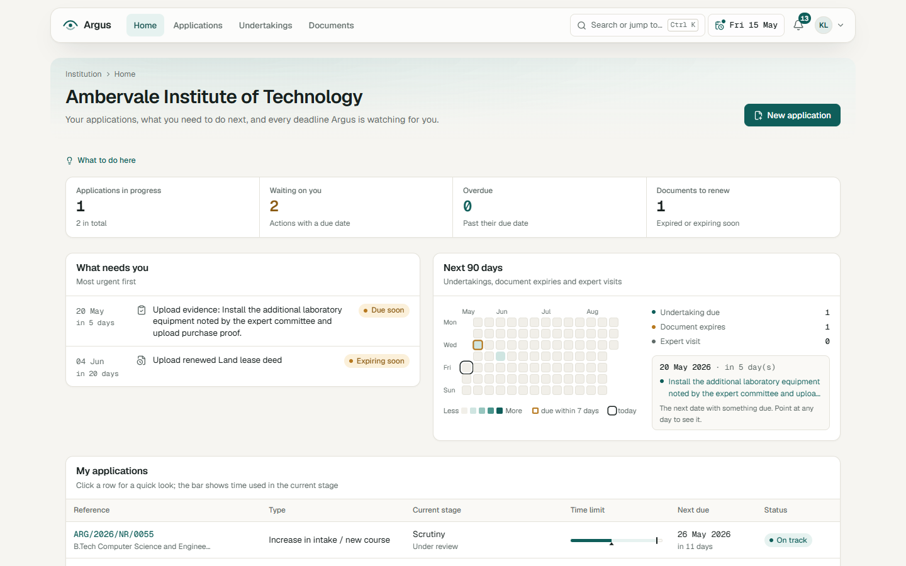
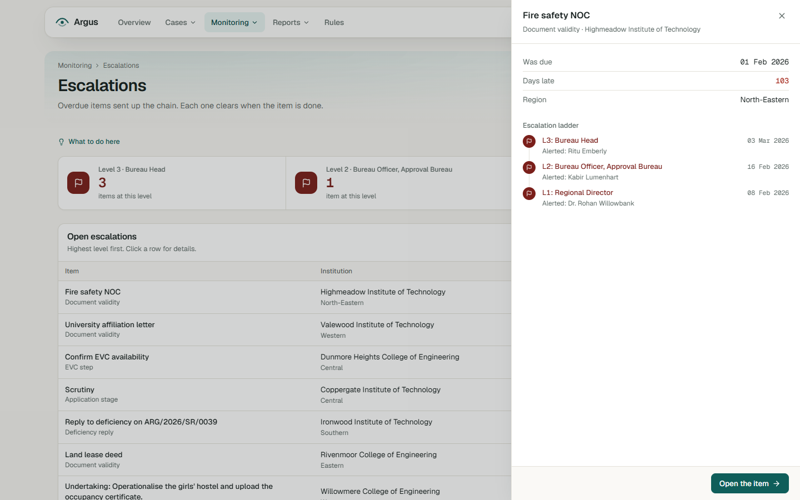
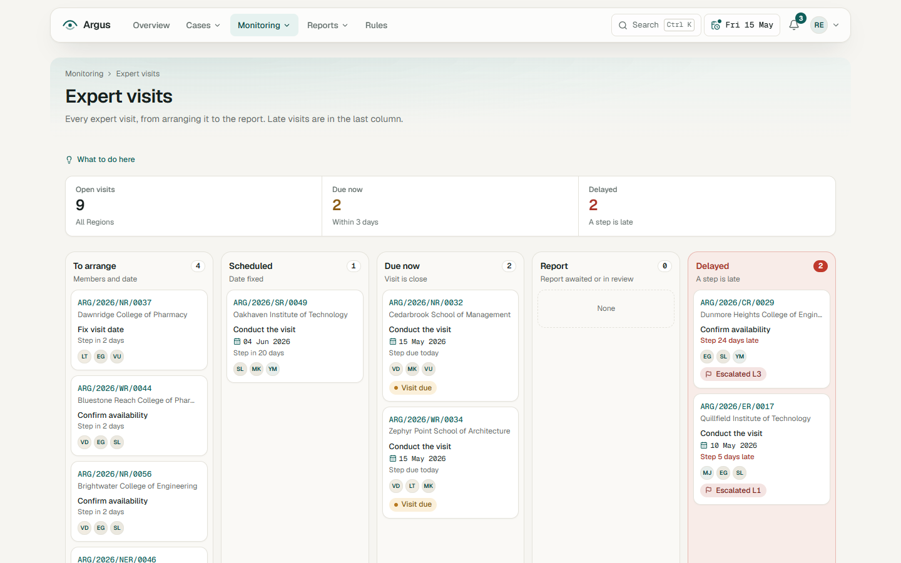
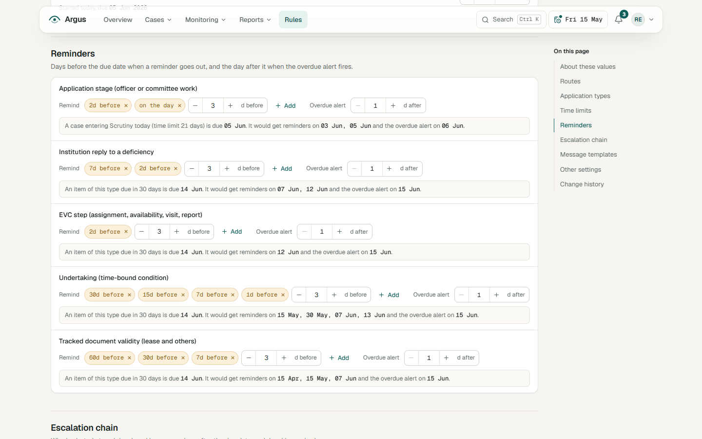

# Argus: technical details

The README is kept short on purpose; this file holds everything else.

## The problem, in full

AICTE approves technical institutions through stages such as scrutiny and re-scrutiny, Expert Visit
Committee (EVC) visits and SAC/SHC review. Some approvals carry time-bound undertakings, and institutions
must keep documents such as land leases valid. Today officers in each Region track all of this by hand, so
deadlines slip, visits get delayed and documents expire unnoticed.

Argus ("the hundred-eyed watchman") routes every application through the stages its type requires, monitors
pendency, ageing, EVC scheduling, undertakings and document validity on role-based dashboards, sends reminders
before deadlines and escalates overdue items L1 to L3 up a configurable chain, and records every step in an
append-only, hash-chained audit trail.

Humans decide. Decisions and committee recommendations are recorded by the competent person, with who, when
and why. Automation is limited to routing, reminders, escalations, drafting and record keeping. Every rule,
time limit and reminder day is an illustrative assumption, not an official APH figure.

## Architecture



All deadlines read time from one simulated platform clock (the date chip in the navbar: +1 day, +7 days,
+30 days, Reset). The clock moves one day at a time and runs the alert tick each day, so reminders fire on
exactly their day.

## Sign-in and sign-out

Sign-in is a demo user picker at `/login`, grouped by role. Picking a user calls `POST /api/auth/login`,
which sets an HMAC-signed session cookie. `POST /api/auth/logout` expires the cookie; after that every
protected endpoint answers 401 and every page sends you back to `/login`. Only `/api/health`, `/api/live`,
`/api/clock` and `/api/users/demo` (the picker) answer without a session. Switch user (avatar menu) opens
the same picker in a dialog. Real login, SSO and password flows are future scope.

## Running locally in detail

Needs Python 3.11 to 3.13, Node 20.9+ (tested on 22.23.4, see `.nvmrc`), pnpm 11 and PostgreSQL 14+.
Install Node with [nvm for Windows](https://github.com/coreybutler/nvm-windows), then pnpm into that Node:

```powershell
nvm install 22.23.4
nvm use 22.23.4             # once, from an admin terminal if nvm asks
npm install -g pnpm@11.9.0
```

- Argus uses its own ports, 8001 (API) and 3001 (web), so it can run next to other projects on 8000/3000.
  Change them with `API_PORT` / `WEB_PORT` in `.env`; the web proxy follows `API_PORT`.
- If a port is busy, `pnpm dev` stops and says which process holds it. `pnpm dev:clean` stops only Argus dev
  servers on those two ports and never touches other programs.
- Write `pnpm run setup` with `run`: `pnpm setup` is a built-in pnpm command. Setup is safe to repeat.
- Works with Neon: use the pooled connection string with `sslmode=require`. Over the internet each query costs
  a round trip (about 90 ms from India to a Neon region), so the app batches writes and caches lookups per
  request; on Vercel, next to the database, everything is much faster.
- No Postgres password at hand? `pnpm db:local` starts a project-local cluster on port 5433 (needs the
  PostgreSQL `bin` folder on PATH); use `DATABASE_URL=postgresql://argus@localhost:5433/argus`.

| Command | What it does |
|---|---|
| `pnpm db:init` | create the tables if they do not exist (never drops data; safe to repeat) |
| `pnpm db:seed` | replace all data with the synthetic dataset (`data/seed.copy.gz`); repeating it never duplicates |
| `pnpm db:generate` | rebuild the dataset by replaying ~300 simulated days through the engines (deterministic; run it on a local database) |
| `pnpm db:reset` | restore the seeded state (same as the Reset button) |
| `pnpm test` | pytest suite in a separate `<db>_test` database; the dataset regeneration test runs only on a local database or with `ARGUS_SLOW_TESTS=1` |
| `pnpm lint` | ruff on the Python code |
| `pnpm smoke` | headless demo scenario through the API, prints the KPI table |
| `pnpm e2e` | Playwright click-through of the demo path in the real UI, including log out and back in (needs `pnpm dev`; uses installed Edge) |
| `pnpm screens <user> <paths…>` | screenshots at 1366x768 and 1920x1080 |
| `node scripts/screens-all.mjs <folder>` | every page for every role, into `screenshots/<folder>/` |
| `node scripts/readme-shots.mjs` | the images in `docs/screenshots/` |

## Measured results

From `pnpm smoke` on the synthetic dataset (guided scenario, then 37 simulated days). Targets are our own
suggestions, not official requirements. Every value is computed live on the Performance page.

| # | KPI | Result | Suggested target |
|---|---|---|---|
| 1 | Workflow routing accuracy (61 applications) | 100% | 100% |
| 2 | Alert timeliness (462 alerts, fired on their configured day) | 100% | 100% |
| 3 | Deadline tracking reliability (38 open overdue items checked) | 0 missed | 0 |
| 4 | Pendency visibility (31 overdue cases on dashboard and report) | 100% | 100% |
| 5 | Manual follow-up reduction (285 reminders, 57 overdue alerts, 120 escalations; 1 follow-up per alert assumed) | 462 | shown as a count |
| 6 | Escalation coverage (38 overdue items) | 100% | 100% |
| 7 | Audit completeness (1,078 records) and chain verification | 100%, chain valid | 100%, valid |
| 8 | Average days per stage, AICTE + institution | Completeness 3.5 + 1.2 · Scrutiny 11.2 + 3.5 · EVC 29.5 · SAC/SHC 7.9 · Decision 3.6 | shown |

The routing self-test on the Performance page also pushes one test application of every type through all its
stages inside a rolled-back transaction: 7 of 7 routed correctly.

## Screenshots

Synthetic data throughout.

| | |
|---|---|
|  |  |
| **Official dashboard** | **Case page** |
|  |  |
| **Institution home** | **Escalations** |
|  |  |
| **Expert visits** | **Rules** |

## Future scope (not built in v1)

- Integration with real AICTE systems, real SSO, DigiLocker and e-Sign, real login and password management
- Real email, SMS and WhatsApp delivery
- Automated document content checks (OCR, authenticity checks)
- AI-based risk scoring or prediction of delays
- Mobile app and multilingual UI
- Advanced analytics and cross-year trends
- An admin / user-management role and self-registration
- Full APH rule coverage for every approval type and scenario
- Geo-tagged inspections and video visits

## Repository layout

| Path | What it holds |
|---|---|
| `backend/db/schema.sql`, `backend/db/__init__.py` | PostgreSQL schema and a small psycopg 3 helper (plain SQL, one transaction per request, a thread-free cache of idle connections) |
| `backend/app/clock` | simulated platform clock: `now(conn)`, `advance(days)` one day at a time |
| `backend/app/rules` | configuration tables: routes, SLA days, reminder offsets, escalation chain, templates, settings; validated and audited updates |
| `backend/app/workflow` | state machine, routing, assignment by workload, deficiency loop with SLA pause, revert, SAC/SHC committee, decision recording, case facts |
| `backend/app/scheduling` | EVC visit steps and the scheduling board |
| `backend/app/compliance` | undertakings, evidence, verification, tracked document validity and renewals |
| `backend/app/alerts` | the idempotent alert tick and escalation engine |
| `backend/app/notifications` | in-app notifications, template rendering, simulated email/SMS outbox |
| `backend/app/documents` | file storage in `bytea`, versions, SHA-256, 2 MB limit, permission-checked download |
| `backend/app/audit` | append-only hash-chained audit log and verification |
| `backend/app/auth` | demo session cookie (HMAC-signed) and scope checks |
| `backend/app/reports`, `backend/app/kpi` | pendency computations shared by dashboards and reports, CSV, KPIs, routing self-test |
| `backend/app/llm` | optional Groq drafting with offline templates |
| `backend/app/api` | FastAPI routes, dashboards, case page payload |
| `backend/app/data` | synthetic data generator, dataset dump/load, Reset snapshot, guided demo steps |
| `data/seed.copy.gz` | the generated dataset (PostgreSQL COPY format), loaded by `pnpm db:seed` |
| `frontend/` | Next.js App Router portal |
| `scripts/` | Windows-friendly `.mjs` and Python helpers (setup, local Postgres, db, smoke, e2e, screenshots) |

## Data model (main tables)

- **Configuration**: `sla_rules`, `stages`, `routes` + `route_stages`, `application_types`, `reminder_rules`,
  `escalation_levels`, `escalation_rules`, `notification_templates`, `settings`.
- **Workflow**: `applications` (with `route_snapshot`, the stage list fixed at submission),
  `application_stages` (one row per attempt, `paused_at` / `paused_seconds` for the SLA pause),
  `deficiencies`, `committee_reviews` + `committee_members`.
- **Scheduling**: `evc_visits`, `evc_members` (availability and offered dates), `visit_reports`.
- **Compliance**: `undertakings`, `evidence_submissions`, `tracked_documents`.
- **Alerts**: `alerts` (unique `alert_key`), `escalations`, `notifications`, `outbox`.
- **Records**: `files`, `audit_log`, `platform_clock`.

## Workflow rules

- An application's route is copied into `route_snapshot` when it is submitted, so later rule changes never
  re-route cases already in flight.
- Completeness check and scrutiny: `in_review` → (deficiency) `awaiting_institution` → `re_review` →
  completed. Raising a deficiency needs a reason of at least 10 characters and pauses the AICTE SLA clock;
  the reply resumes it and extends the stage due date by exactly the paused time.
- Completing a stage routes the case to the next stage of its route automatically and assigns it: review
  stages by workload (fewest active stages in the Region), decision to the Regional Director, SAC/SHC to
  the two least-loaded SAC members.
- EVC: assignment → availability → date → visit → report → review. Each step has its own limit
  (`evc_*` SLA rules); the visit step is due on the visit date itself.
- Revert sends a case at EVC, SAC/SHC or decision back to an earlier completeness check or scrutiny stage
  with a reason; open visits and reviews for that stage are cancelled.
- Decisions: only an official of rank 2 or above (Regional Director, Bureau) can record one, with a reason.
  "Approved with undertakings" creates one undertaking per condition. Illegal transitions return HTTP 409.

## The alert tick

`run_alert_tick(conn, now)` (in `backend/app/alerts`):

1. Takes an advisory lock so two ticks never overlap.
2. Moves simulated delivery one step (`sent → delivered/failed`, then `queued → sent`).
3. Builds the list of open tracked items in SQL: active non-EVC stages (not while paused), open deficiency
   replies, EVC steps, open undertakings, valid or rejected documents. Each has a due date, a start date
   and a cycle (for example a document's expiry date, so a renewed document starts a fresh cycle).
4. **Reminders** fire only on their exact day (`due + offset = today`) and only if the item and the rule
   already existed that day. **Overdue alerts** and **escalations** catch up if needed, and store the day
   they should have fired.
5. Inserts each alert with `ON CONFLICT (alert_key) DO NOTHING`; only rows really inserted create
   notifications, outbox rows, escalation rows and audit entries. Running the tick twice changes nothing.
6. Resolves open escalations whose item is no longer open.

It runs on `/api/live` polls (only when the clock moved or the last tick is over 15 s old, and only if no
other tick holds the lock), on every clock advance (one tick per simulated day, plus one for the current
day first) and from `/api/cron/tick` (Vercel Cron; set `CRON_SECRET` to require `Authorization: Bearer`).

Default rules (illustrative): stage reminders −2 and 0 days, overdue +1, escalation +3/+7/+14 days;
deficiency replies −7/−2, +7/+15/+30; undertakings −30/−15/−7/−1, +7/+15/+30; documents −60/−30/−7,
+7/+15/+30. Escalation chain: L1 Regional Director, L2 Bureau Officer, L3 Bureau Head. All of it is
editable on the Rules page.

## Audit trail

Each entry stores `prev_hash` and `hash = SHA-256(prev_hash | canonical JSON of the entry)`. Entries are
written in the same transaction as the change they describe, under an advisory lock that serialises the
chain. A database trigger rejects `UPDATE` and `DELETE`. `verify_chain` recomputes every hash and reports
the first broken entry. Tests prove that editing or deleting an entry is detected.

## Synthetic data

`pnpm db:generate` runs `backend/app/data/seed.py`: it creates 7 Regions, 40 fictional institutions,
69 users (40 institution heads, 17 officials, 12 committee members) and 40 tracked documents, then
replays 300 simulated days through the real engines with per-case plans, ticking the alert engine every
day. The result (60 applications, 33 EVC visits, 27 undertakings, alerts, escalations, notifications and
an audit chain of about 1,800 entries) is consistent by construction and byte-identical on every run.
It is dumped to `data/seed.copy.gz`, which `pnpm db:seed` loads in a few round trips (fast on Neon too).
The Reset button restores a snapshot schema taken right after loading.

Scripted demo cases are tagged in `applications.demo_tag`: `demo_scrutiny`, `demo_returned`,
`demo_overdue_scrutiny`, `demo_l2`, `demo_evc_delayed`, `demo_visit_availability`, `demo_visit_report`,
`demo_sac`, `demo_decision`, `demo_legacy` (Ambervale undertaking due in 5 days), `demo_verification`,
`demo_overdue_undertaking`.

Names are invented: imaginary towns, and person surnames that are unusual nature words.

## KPI definitions

| KPI | How it is measured |
|---|---|
| Routing accuracy | Each application's non-reverted stage history must equal its route snapshot in order (prefix for open cases) |
| Alert timeliness | `ist_date(fired_at) = trigger_date` for every alert |
| Deadline tracking reliability | Independent SQL lists open items past due with no overdue alert (target 0) |
| Pendency visibility | Overdue cases from an independent query must appear on the dashboard and in the overdue report |
| Manual follow-up reduction | Count of automatic reminders, overdue alerts and escalations × an assumed setting (1) |
| Escalation coverage | Every overdue item must have each level whose day has passed, escalated on that day |
| Audit completeness | 12 record types matched to their audit actions, plus chain verification |
| Processing time per stage | Completed stages: average total days, institution days (paused time) and AICTE days |

## Security and scope

- Demo session: the cookie holds the user id with an HMAC signature (`SESSION_SECRET`). Forged cookies are rejected.
- Institutions see only their own cases, undertakings, documents and files; committee members only cases
  they are assigned to; only Bureau officers edit rules; only officials verify; only rank 2+ officials decide.
- File download checks the same scope. Uploads are limited to 2 MB and to PDF, PNG, JPEG and text.
- Parameters are always bound (no string-built SQL with user input).

## UI notes

- Theme "stone and pine": tokens in `frontend/app/globals.css` (see CLAUDE.md section 9). Small text on
  tinted fills uses the `-ink` variants (amber-ink `#8A5A12` on amber-tint is 5.2:1, red-ink on red-tint 5.5:1);
  the region tiles and chart ramp were checked so text on every step passes AA.
- Geist Sans and Geist Mono are bundled by the `geist` package, so the UI works offline.
- Tables support keyboard row navigation (arrow keys, Enter) and a side-sheet quick look; motion is
  transform/opacity only and switches off under `prefers-reduced-motion`.
- Polling `/api/live` every 3 s (6 s when the tab is hidden). The response carries the latest audit id;
  when it changes, every visible view refetches quietly.
- A request taking longer than 2.5 s shows "Waking up the server"; an unreachable API shows a Retry banner.

## Deploying on Vercel

1. Create a Neon database and run `pnpm db:init` and `pnpm db:seed` against it from your machine
   (`DATABASE_URL` in `.env`). Use Neon's pooled connection string for the deployed app.
2. Import the GitHub repo in Vercel. `vercel.json` defines two services: `web` (Next.js in `frontend/`)
   and `api` (FastAPI, `backend/app/main.py`, dependencies in `backend/requirements.txt`), with `/api/*`
   routed to the API. If your Vercel account does not offer services yet, set the project's Root Directory
   to `frontend`, deploy the API as a second project from `backend/`, and set `ARGUS_API_ORIGIN` on the web
   project to the API's URL (the Next.js rewrite then proxies `/api`).
3. Set `DATABASE_URL`, `SESSION_SECRET`, optionally `GROQ_API_KEY`, `LLM_MODEL` and `CRON_SECRET` in the
   Vercel project settings. Never commit `.env`.

Nothing in the app keeps state in memory or needs a long-running process: all state is in PostgreSQL and
the alert tick runs inside requests.

## Simplifications in v1

- Demo user picker instead of real login (by design; listed as future scope).
- Regional officers see all Regions' cases when they choose "All Regions"; strict per-Region data
  isolation for officials is not enforced (institutions and committees are strictly scoped).
- The simulated clock is global (shared by everyone using the same database).
- EVC availability uses a simple date picker; there is no calendar integration.
- The case summary and letters are drafts only; nothing is sent automatically.
